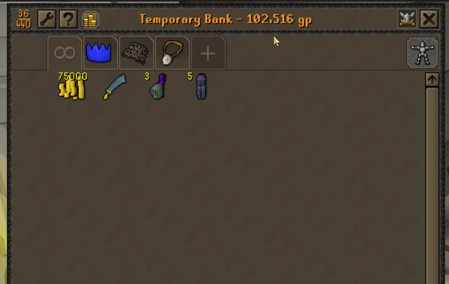
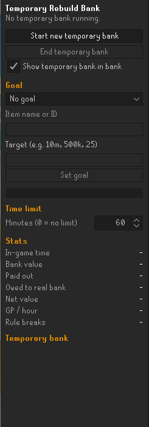
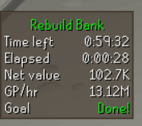

# Temporary Rebuild Bank

A RuneLite plugin for **rebuild challenges and series**. Press Start and your bank appears empty: you rebuild from 0 gp, with your progress, goal, in-game time, GP/hr and PK stats tracked separately from your real bank.

Your real bank is never touched. The plugin only changes what you see in the bank interface and keeps its own record of what you add and take out.

| Your temporary bank | Side panel with a goal |
|---|---|
|  |  |

## Features

### A fresh, empty bank

- Press **Start new temporary bank** in the side panel (chest icon). Everything you own now counts as your hidden "real bank", and the bank interface shows only your temporary bank, laid out without gaps. The bank title shows its value. If your bank isn't open when you press Start, the starting point is recorded the next time you open it.
- **Deposits** go into the temporary bank. **Withdrawals** come out of it first.
- **View switch:** a small button next to the bank's "?" switches between your temporary and real bank at any time. In the temporary view it shows gold coins (switch to your real bank); in the real view it shows the plugin's chest with green arrows (switch back). A checkbox in the side panel does the same.
- **Withdraw-All** never takes your real stack. If your temporary bank has less, the click is blocked and a chat message tells you which option takes exactly what you own (Withdraw-1/5/10/your last X, or Withdraw-X and the number to type).
- **Potion storage** isn't part of the temporary bank: in the temp view, taking potions out of it is blocked. Switch to your real bank to use it.
- In the temp bank view, withdrawals that would dip into your real bank are blocked. In the real bank view nothing is blocked. If one gets through anyway (e.g. typing a too-big Withdraw-X), the extra is **owed**. It shows in red at the top of the temporary bank ("You owe your real bank") and in the side panel and overlay. Depositing it pays the debt back first, so only what was really yours counts towards the temporary bank.

 

### Untradeables
Untradeables already in your bank sit **locked** below a divider at the bottom of the temporary bank. Right-click one and choose **Unlock** to move it into your temporary bank.

- **Unlock cost**:
  - *Locked*: they can't be unlocked.
  - *Free*: unlocking costs nothing.
  - *Perdu price*: unlocking costs what Perdu charges to repair or replace the item (e.g. fire cape 150k, avernic defender 600k).
  - *Custom price*: set your own costs, one per line (`Fire cape: 1m`).
- You pay **once per item type**. That unlocks the whole stack for the rest of the run.
- Costs are paid **only with coins in your temporary bank**. Coins in your real bank are never used and stay where they are. If you can't afford it, the unlock is refused.
- **Unlockable items** preset:
  - *Perdu items*: things Perdu repairs or sells back (fire/infernal cape, defenders, void, god capes...).
  - *Combat gear* (default): any untradeable gear with combat stats, which adds skillcapes, cosmetic defenders and similar.
  - *Everything*: all untradeables, including quest items (not recommended).
- **Rune pouch:** always offered in the untradeables section, whatever the preset, since you can only own one. With *Perdu price* it costs whatever a **rune pouch note** sells for on the Grand Exchange (a divine rune pouch adds a Thread of Elidinis); with *Custom price* it uses your amount if listed, otherwise the note price.
- **Looting bag:** always part of your temporary bank, never locked or owed. You can only own one, so otherwise you could never get another during the run.
- **Always allow** / **Never allow** lists adjust any preset. Names are comma separated, and a trailing `*` matches any ending, e.g. `Graceful*`.
- **Untradeables you get during the run are yours.** A fire cape you earn, or moonclan gear you buy on Lunar Isle, goes straight into your temporary bank when deposited, with no unlock needed. Untradeables you already had when you pressed Start, carried or worn, are pre-run items: once deposited they join the locked section and follow your **Unlock cost** setting.
- **Charged, degraded or combined versions of tradeable gear** (abyssal tentacle, bowfa, crystal armour, degraded barrows, charged Tumeken's shadow...) are treated as normal items and valued from their tradeable parts.

### Goals, timer and stats

- **Goals**: temporary bank value, coins, or a quantity of any item. The side panel shows a progress bar. Reaching the goal stops the timer and sends a chat message and notification with your time and GP/hr.
- **In-game timer**: counts in-game time only (game ticks), and pauses while you're logged out.
- **Time limit**: set it in the side panel (minutes, 0 = none).
- **Timer overlay**: time left on your time limit, time elapsed, net value, GP/hr, goal progress and PK stats. It flashes slowly red when the time limit runs out. Hold Alt and drag to move it.
- **Player kills**: once you get a PK, the number of kills and the average kill value are shown. Kills with ground loot and kills with loot keys both count; a loot key's value is added when you open the loot chest.
- **GP/hr** = net value ÷ in-game time. **Net value** = what your temporary bank is worth minus anything owed to your real bank (never below 0), so items bought with real-bank coins don't count until you pay them back.

 

### Other settings
- **Buy from hidden bank**: allows withdrawing tradeables from your real bank, paying their GE price with temporary bank coins. Only as many as your coins can pay for; anything beyond that is owed. Coins themselves can never be bought.
- **Starting items are owed** (on by default): everything you're wearing or carrying when you press Start, including what's in your looting bag, is pre-run stuff. Tradeables came from your real bank, so they show as owed (in red) until you deposit them back. Eating, spending or dropping them keeps them owed until you replace them. Untradeables you start with show as owed too; once you deposit them they join the locked section, like the ones already in your bank. Turn it off and everything you start with is yours and counts as progress. For a clean start, bank your inventory, gear and looting bag first.
- **Value untradeables**: counts untradeables at their high alch value. When off, they count as 0 gp.

### Logging in and out
Each account has its own temporary bank, saved in your RuneLite profile. Changes made while the plugin wasn't watching (another client, mobile, a deposit box) are picked up the next time you open the bank.

As a safety net, every save is also written straight away to a small backup file in the plugin's own RuneLite folder (`.runelite/plugin-data/temporary-rebuild-bank`). If RuneLite is closed abruptly before it saves its settings, your run is restored from the backup when you log back in.

## Known limitations
- The seed vault and group storage aren't tracked. Potion storage can't be used from the temp view.
- The game only shows a looting bag's contents while you check it. To have them counted as starting items, check the bag (right-click > Check) less than a minute before pressing Start; otherwise the plugin warns you. For the cleanest start, empty the bag into your bank first.
- The temporary view applies to the main bank interface. Bank tag tab layouts may override it inside tag tabs.

## Building and testing
Requires Java 11. Run `./gradlew run` (or `gradlew.bat run` on Windows) to launch RuneLite in developer mode with the plugin loaded. Log in using [Jagex Accounts in the development client](https://github.com/runelite/runelite/wiki/Using-Jagex-Accounts). `./gradlew test` runs the unit tests.

## Credits
Made by **shieldman4**.

Perdu repair and Lost Property shop prices (`src/main/resources/com/rebuildbank/perdu_costs.txt`) come from the [Old School RuneScape Wiki](https://oldschool.runescape.wiki/w/(broken)) and are used under [CC BY-NC-SA 3.0](https://creativecommons.org/licenses/by-nc-sa/3.0/).

## License
BSD 2-Clause. See [LICENSE](LICENSE).
