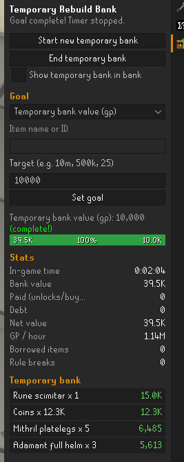
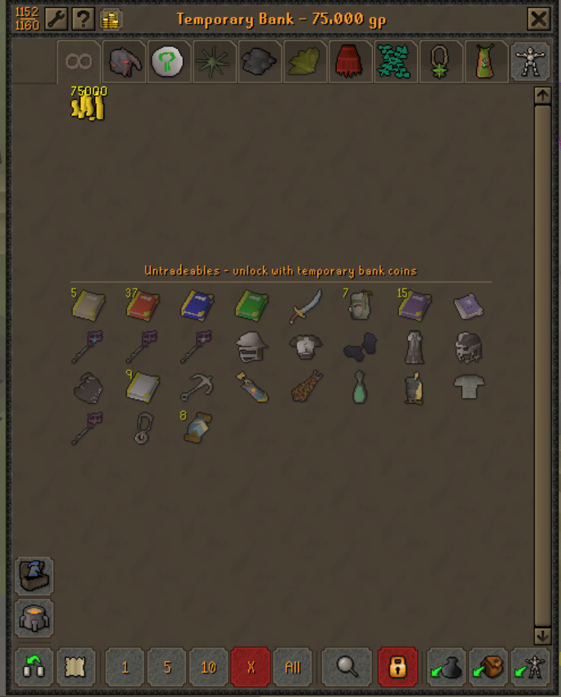
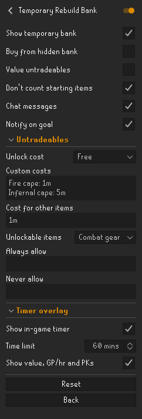

# Temporary Rebuild Bank

A RuneLite plugin for **rebuild challenges and series**. Press Start and your bank appears empty: you rebuild from 0 gp, with your progress, goal, in-game time, GP/hr and PK stats tracked separately from your real bank.

Your real bank is never touched. The plugin only changes what you see in the bank interface and keeps its own record of what you add and take out.

| Your temporary bank | Side panel with a goal |
|---|---|
|  |  |

## Features

### A fresh, empty bank
- Press **Start new temporary bank** in the side panel (chest icon). Everything you own now counts as your hidden "real bank", and the bank interface shows only your temporary bank, laid out without gaps. The bank title shows its value.
- **Deposits** go into the temporary bank. **Withdrawals** come out of it first.
- **Real bank / Temp bank** button in the bank's title bar switches between the two views at any time. A checkbox in the side panel does the same.
- **Withdraw-All** takes only what your temporary bank has. When the bank already has an option for that exact amount (1, 5, 10 or your last X), it uses that one. Otherwise it opens Withdraw-X and tells you the number to type.
- Withdrawals that would dip into your real bank are blocked. If one gets through anyway (e.g. typing a too-big Withdraw-X), it's recorded as a **rule break** until you deposit it back.

### Untradeables
Untradeables already in your bank sit **locked** below a divider at the bottom of the temporary bank. Click one and choose **Unlock** to move it into your temporary bank.

- **Unlock cost**:
  - *Locked*: they can't be unlocked.
  - *Free*: unlocking costs nothing.
  - *Perdu price*: unlocking costs what Perdu charges to repair or replace the item (e.g. fire cape 150k, avernic defender 600k).
  - *Custom price*: set your own costs, one per line (`Fire cape: 1m`).
- You pay **once per item type**. That unlocks the whole stack for the rest of the run.
- Costs are paid **only with coins in your temporary bank**. Coins in your real bank are never used and stay where they are. If you can't afford it, the unlock is refused.
- **Unlockable items** preset:
  - *Perdu items*: things Perdu repairs or sells back (fire/infernal cape, defenders, void, god capes...).
  - *Combat gear* (default): any untradeable gear with combat stats, which adds skillcapes, cosmetic defenders and similar.
  - *Everything*: all untradeables, including quest items (not recommended).
- **Always allow** / **Never allow** lists adjust any preset. Names are comma separated, and a trailing `*` matches any ending, e.g. `Graceful*`.
- **Untradeables you earn or bring are yours.** A fire cape you get during the run, or untradeables you're wearing when you start, go straight into your temporary bank when deposited.
- **Charged, degraded or combined versions of tradeable gear** (abyssal tentacle, bowfa, crystal armour, degraded barrows, charged Tumeken's shadow...) are treated as normal items and valued from their tradeable parts.

### Goals, timer and stats
- **Goals**: temporary bank value, coins, or a quantity of any item. The side panel shows a progress bar. Reaching the goal stops the timer and sends a chat message and notification with your time and GP/hr.
- **In-game timer**: counts in-game time only (game ticks), and pauses while you're logged out.
- **Timer overlay**: time left on your time limit, time elapsed, net value, GP/hr, goal progress and PK stats. It flashes slowly red when the time limit runs out. Hold Alt and drag to move it.
- **Player kills**: once you get a PK, the number of kills and the average kill value are shown. Kills with ground loot and kills with loot keys both count; a loot key's value is added when you open the loot chest.
- **GP/hr** = net value ÷ in-game time. **Net value** = temporary bank value minus any debt.

### Other settings

- **Buy from hidden bank**: allows withdrawing tradeables from your real bank, paying their GE price with temporary bank coins. Anything your coins can't cover shows as debt.
- **Don't count starting items**: tradeables you're wearing or carrying when you press Start go back to your real bank when deposited, instead of counting as progress.
- **Value untradeables**: counts untradeables at their high alch value. When off, they count as 0 gp.

 

### Logging in and out
Each account has its own temporary bank, saved in your RuneLite profile. Changes made while the plugin wasn't watching (another client, mobile, a deposit box) are picked up the next time you open the bank.

## Known limitations
- Potion storage, the seed vault and group storage aren't tracked.
- The temporary view applies to the main bank interface. Bank tag tab layouts may override it inside tag tabs.

## Building and testing
Requires Java 11. Run `./gradlew run` (or `gradlew.bat run` on Windows) to launch RuneLite in developer mode with the plugin loaded. Log in using [Jagex Accounts in the development client](https://github.com/runelite/runelite/wiki/Using-Jagex-Accounts). `./gradlew test` runs the unit tests.

## Credits
Made by **shieldman4**.

Perdu repair and Lost Property shop prices (`src/main/resources/com/rebuildbank/perdu_costs.txt`) come from the [Old School RuneScape Wiki](https://oldschool.runescape.wiki/w/(broken)) and are used under [CC BY-NC-SA 3.0](https://creativecommons.org/licenses/by-nc-sa/3.0/).

## License
BSD 2-Clause. See [LICENSE](LICENSE).
